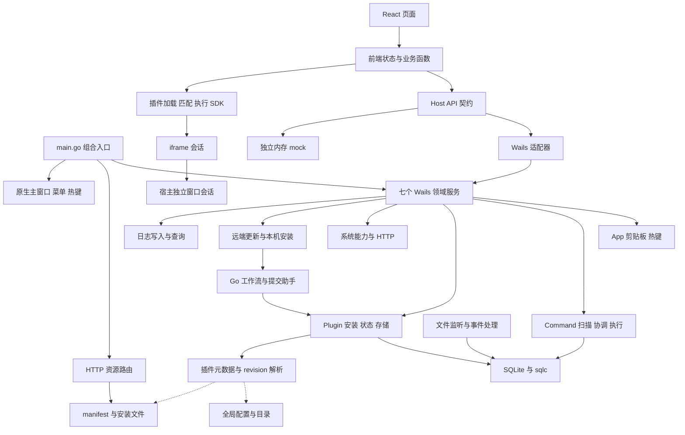

# WaTools 架构与代码精简审查报告

[文档索引](../README.md) · [当前架构](../architecture/architecture.md) · [优化 Backlog](../backlog/README.md)

审查日期：2026-10-07。代码基线：`fb22aa12af887e013a4afdb28acfd46f2d4c8152`，开始审查时工作区无改动。状态：待 review，本轮仅新增报告与索引，不实施业务重构。适用范围为当前 macOS 开发者自用阶段；Windows 和公开分发继续保持既有延期边界。

当前架构适合项目规模，建议沿用 **模块化单体、明确的宿主适配边界、可测试的业务模块，以及前端纯函数与状态分离**。七个领域服务、统一 Host API、不可变插件 revision、有界剪贴板快照及会话状态交付，都应保留。主要优化空间在模块内部和模块之间的状态所有权：仍有多处重复规则、读写混合职责、隐式初始化和兼容代码残留。

“最优雅”没有脱离需求的统一答案。对此项目，更有价值的标准是：一个行为只有一个权威实现；依赖在需要替换的边界显式传入；数据、资源和异步任务有明确所有者；失败能向调用方表达；增加一个插件或 API 不必修改多份平行逻辑。当前实现部分符合这些标准，仍值得做一轮渐进整理，暂不需要更换框架、全面接口化或引入完整 DDD 分层。

补充审查结论：**架构方向合理，但编码实践尚未一致达到要求，Go 错误处理需要纳入实质重构。** 下文在 20 个模块之外增加跨模块规范 C01–C11、错误处理条目 E01–E10，以及对应的实施和验收约束。“最佳实践”以当前需求、语言官方惯例和可验证的行为为依据；不将个人风格偏好作为必须重构的理由。

## 架构判断

| 维度 | 当前判断 | 主要依据 |
| --- | --- | --- |
| 技术栈与进程划分 | 合理，继续保留 | Go 承接原生与持久化，React 承接交互，Wails 是桌面桥接边界 |
| 服务边界 | 基本清晰 | App、Command、Plugin、Storage、System、Update、Log 七个出口，各有具体职责 |
| 依赖方向 | 局部需要整理 | `models` 执行磁盘及系统操作；业务模块仍主动取得全局 DB/config |
| 状态所有权 | 已改善，尚未完全收敛 | 剪贴板与启动上下文已有明确类型；扫描和 watcher 分别写 DB，插件列表混合元数据与执行缓存 |
| 类型契约 | 基础较好，有维护重复 | Go DTO、生成 TS、独立 HostAPI、前端运行类型并存；个别适配依赖双重断言 |
| 生命周期与并发 | 核心已有保护，需保留 | revision/focus generation、锁外原生调度、取消、退出等待都有实际实现 |
| 工程化精简 | 有明显收益空间 | 版本比较、解压、watcher 通用逻辑、官方目录发现、usage 调度重复 |
| 测试可维护性 | 有行为覆盖，部分与源码形状耦合 | 前端大量测试从 HTML 或组件抽取函数，Go 扫描协调和图标缺少直接测试 |
| 编码实践一致性 | 尚未达到，需按语义重构 | 部分 DB 查询吞错、补偿路径丢失错误链、边界错误误分类、异步状态缺少请求归属 |

不建议将所有文件套入 Controller → Service → Repository 三层，也不建议为每个具体类型新建接口。Wails 领域服务已经承担传输边界；业务模块只在数据库、原生窗口、进程或网络需要替换时引入窄接口。减少重复转发和隐式依赖，比增加层数更有价值。

## 当前系统模块与调用关系

下图按实际调用关系简化，虚线表示仍存在的全局配置和磁盘依赖。



| 编号 | 模块 | 主要入口 | 核心优化方向 |
| --- | --- | --- | --- |
| M01 | 组合入口与配置 | `main.go`、`config/` | 显式资源初始化与关闭，收敛有副作用的目录 getter |
| M02 | 原生窗口 菜单 热键 | `internal/app/`、`internal/app_menu/` | 减少 App 与热键管理器的双向单例依赖 |
| M03 | 剪贴板与启动素材 | `clipboard_snapshot.go`、`launcher-input.ts` | 保留快照协议，以跨语言用例保护边界规则 |
| M04 | 应用扫描与文件监听 | `internal/command/application/`、`watcher/` | 统一状态协调，合并平台无关样板 |
| M05 | 命令执行与系统操作 | `command.go`、`operator/`、`models/command*` | 明确执行目录所有者，分离数据和平台动作 |
| M06 | SQLite 与数据访问 | `pkg/db/` | 错误透传、统一事务提交、针对性查询 |
| M07 | 宿主服务 系统能力与前端契约 | `internal/host/`、`internal/api/`、`api/host/` | 保留边界，统一能力规则，增加契约一致性验证 |
| M08 | 插件目录 状态 存储 凭据 | `plugin.go`、`models/plugin.go`、`secrets/` | 分离元数据和可变状态，减少重复加载和宽锁 |
| M09 | 插件安装与打包 | `installer.go`、`cmd/pluginctl/` | 共享目录发现与基础规则，保留事务边界 |
| M10 | HTTP 资源与图标 | `internal/handler/` | 路由完整性、统一 revision 解析、图标缓存失效 |
| M11 | 插件加载 匹配 执行 SDK | `api/plugin.ts`、`lib/plugin*` | 目录读取与代码加载分离，显式 API 执行路径 |
| M12 | 插件会话与独立窗口 | `plugin_window.go`、`wa-plugin*` | 提炼 iframe 生命周期，明确分离状态和取消 |
| M13 | 启动器 搜索 排序 | `wa-command.tsx`、各 items hook | 分离执行协调与视图，统一排序输入 |
| M14 | 前端数据生命周期与使用统计 | `stores/`、`usage-buffer.ts` | 显式初始化，共享统计调度，保留失败重试 |
| M15 | 管理中心与管理页面 | `wa-management.tsx`、插件与日志管理页 | 页面状态与视图分离，收敛选择和异步请求状态 |
| M16 | 日志与诊断 | `pkg/logger/`、`api/log.ts` | 日志等级一致，结构化来源，按需要改进查询 |
| M17 | 本机源码安装与开发工作流 | `localinstall/`、`workflow/`、CLI | 明确任务阶段，提炼进程机制，减少重复文件扫描 |
| M18 | 远端更新与发布 | `internal/update/`、发布 workflow | 共享基础机制，保留更新策略和延期安排 |
| M19 | 六个官方插件 | `plugins/official/` | JS 从 HTML 拆出，少量共享助手，各自保留业务模型 |
| M20 | 检查 测试 依赖 文档 | `scripts/`、CI、配置与文档 | 行为测试直接导入模块，生成与规则一致性检查 |

## 发现的分类与优先级

下文的 **P1** 表示下一轮优先处理的可靠性或低风险精简，**P2** 表示职责整理，**P3** 表示需要先测量或等待使用需求的优化。它们是本报告的排序，不更改已有 backlog 的状态。

证据强度分三类：**已复现**有本轮探针结果；**代码确认**可从实际调用链直接确定；**待验证风险**根据并发或资源机制推断，需要专项场景证明影响。性能建议均未承诺改善比例。

### M01 组合入口与配置

源码：[main.go](../../main.go)、[config.go](../../config/config.go)、[data.go](../../config/data.go)、[wa_db.go](../../pkg/db/wa_db.go)。

当前 `main.go` 显式创建 command、plugin、api、update 实例，并把同一个插件实例交给服务和资产路由，这一组合方式值得保留。配置解析和日志初始化在 `init()` 中，DB 则在首次调用 `GetWaDB()` 时创建；`ProjectDataDir()` 兼有环境解析、建目录、旧数据迁移和 panic 行为。

- **P2 代码确认：集中资源启动与退出。** 建议启动时明确完成目录准备、日志和 DB 创建，再传入需要它们的业务模块。DB 与 rotating writer 已有 `Close()`，当前入口没有对应的统一关闭安排。先关闭业务任务再关闭 DB/日志，避免依靠进程退出承担全部收尾。
- **P2 代码确认：分离目录解析与目录准备。** 让“读取已确定目录”成为无副作用操作，把迁移留在一次性准备阶段。保留显式 `WATOOLS_DATA_DIR` 不导入真实数据的规则；不把测试中的环境覆盖缓存成不可替换的进程全局值。
- **P3：服务注册重复不值得独立做大抽象。** 七次 `NewServiceWithOptions` 的少量重复可局部整理，但不要创建基类、注册框架或新的生命周期总线。

收益：启动失败更容易定位，DB 与目录更容易隔离测试。风险：初始化顺序、热键主线程和退出等待属于高敏感边界。验收：目录准备失败可返回启动错误；退出顺序明确；迁移与临时数据测试继续通过。

### M02 原生窗口 菜单与热键

源码：[app.go](../../internal/app/app.go)、[hotkey_manager.go](../../internal/app/hotkey_manager.go)、[hotkey_registration_darwin.go](../../internal/app/hotkey_registration_darwin.go)、[app_menu.go](../../internal/app_menu/app_menu.go)。

App 管理窗口几何、显隐、剪贴板和热键接入；HotkeyManager 管理配置、监听与注册。macOS 原生注册统一在 AppKit 线程执行，注册错误能返回，配置失败会恢复旧配置，菜单重载指向当前窗口。这些保护有实际必要。

- **P2 代码确认：用触发回调替代双向单例查询。** App 取得 HotkeyManager，HotkeyManager 的窗口快捷键回调又调用 `GetWaApp()`。可在组合入口传入 `toggleLauncher` 回调，先解除这条业务依赖，再评估是否有必要移除整个单例。
- **P1 代码确认：清理旧字段和过时注释。** `WaApp.hotkeyListener` 没有仓库内使用点；`GetHotkeys/UpdateHotkey` 仍标注 Wails binding method，但七服务契约没有暴露它们。保留有测试覆盖的配置能力，修正出口说明，不直接因“前端未调用”删除配置实现。
- **P2：按平台操作继续拆分。** 不为缩短 `app_darwin.go` 把 Objective-C 剪贴板、屏幕定位和快捷键强行合成通用抽象；可按原生资源拆文件，保持少量稳定入口。

验收：快捷键冲突、配置回滚、菜单在独立窗重载、快速退出均不退化；涉及主线程调度的更改必须有原生检查。

### M03 剪贴板与启动素材

源码：[clipboard_snapshot.go](../../internal/app/clipboard_snapshot.go)、[app.ts](../../frontend/src/api/app.ts)、[launcher-input.ts](../../frontend/src/lib/launcher-input.ts)、[plugin-context.ts](../../frontend/src/lib/plugin-context.ts)。

当前 `LauncherInput` 用内联正文和剪贴板快照两种类型表达素材；完整原文只在选择插件或复制时解析，摘要不作为正文。有版本、预算、续租和释放机制，并通过 revision 拦截晚到结果。这是本系统较成熟的设计。

- **P2 代码确认：共享测试数据，而非强行共享跨语言算法。** Go 与 TS 都实现 2000 单元内联阈值、128 UTF-16 单元首尾片段及 Unicode 边界规则。增加一份正文和预期结果的 fixture，两边分别运行；不要为了消除文本相似度新增运行时配置服务。
- **P2：让启动上下文容器具备显式清理入口。** `plugin-context.ts` 中 Map、expiry timer 和旧存储迁移状态为模块级资源，可为根生命周期和测试提供 `dispose/reset`。保留不重新读取当前剪贴板、路由切换不提前释放源素材的语义。
- **P3 待测量：大文本跨 WebView 的复制和保留成本。** 主窗、Go 会话和新窗可能同时持有输入/状态；先测典型大 JSON 的传输耗时和峰值内存，再讨论共享引用或分块。不要删掉快照保护来减少几行代码。

验收：空白、NUL、Emoji、超长正文保持精确；快照过期明确报错；取消、失焦和新输入不被旧异步结果覆盖。

### M04 应用扫描与文件监听

源码：[command.go](../../internal/command/command.go)、[app_manager.go](../../internal/command/watcher/app_manager.go)、[fs_watcher.go](../../internal/command/watcher/fs_watcher.go)、[watcher 配置](../../internal/command/watcher/config_darwin.go)、[平台错误处理](../../internal/command/watcher/error_handler_darwin.go)。

周期扫描和 fsnotify 是互补机制，应保留周期扫描作为遗漏事件的补偿。当前周期路径在 `updateApplications()` 中直接分类和写 DB，watcher 的 `defaultAppEventHandler` 另行查整表、判断路径存在并写 DB。周期路径的 `ApiMutex/reconcileMu` 没有覆盖 watcher 的读后写流程。

- **P1 代码确认：接通配置或移除无效配置面。** `WatcherConfig.DebounceInterval/EventBufferSize` 会验证，但实际 `FSWatcher` 使用固定 500ms 和容量 100，构造时没有接收这两个配置。当前配置看似可调，实际不生效。
- **P1 代码确认：合并平台无关代码。** 两个 `error_handler_*` 文件除注释外的错误处理、重试与 metrics 方法相同；两个 `config_*` 的验证与 getter 相同，仅少数默认 delay 不同。将共用实现移到通用文件，平台文件仅保留默认值与原生路径/事件规则。
- **P2 代码确认，存在待验证并发风险：统一应用变更协调。** watcher 负责“路径可能变化”的通知，一个应用目录协调者负责解析、按路径匹配、保留 ID/usage、写入并发出变更事件。避免两个路径各自“查到不存在后插入”。具体并发是否产生约束错误需加入周期扫描和 watcher 同路径交错用例。
- **P2：针对路径读取。** `OnAppAdded/Removed/Modified` 每次读完整应用列表，应使用 `GetApplicationByPath` 或一次协调快照。优先统一流程，再优化查询，避免只加缓存产生第三份状态。

验收：实际配置生效；安装、替换、移除和重复事件保持稳定 ID/usage；周期与监听交错不会重复插入；停止后无晚到写入。

### M05 命令执行与系统操作

源码：[command.go](../../internal/command/command.go)、[command models](../../pkg/models/command.go)、[macOS operations](../../internal/command/operator/operator_darwin.go)、[CommandService](../../internal/host/command.go)。

当前命令数据和执行器通过 `CommandRunner` 关联，服务边界有 typed response。`GetApplicationCommands/GetOperationCommands` 同时返回列表并刷新可执行 runner，`TriggerCommand` 复制 runner 切片后线性查找。`ApplicationCommand.OnTrigger` 在 models 内检查路径并调用系统打开。

- **P2 代码确认：执行目录不应依赖列表读取的副作用。** 在应用目录更新时同步更新按 triggerId 索引的执行器，列表查询只读。这样不需要“前端先读列表”才能准备执行器，也能明确 watcher 后执行器何时更新。
- **P2：适度分离模型和平台动作。** 把应用打开/用户应用判定放回 application 或 execution 模块；models 主要保留数据。不要为固定几条系统操作建立复杂命令总线。
- **P3 待测量：索引查找。** Map 的价值首先是明确执行目录所有权，是否能改善实际延迟取决于命令数量，不能仅凭线性扫描就宣称性能瓶颈。

验收：初始化、应用变更和删除后的执行结果明确；错误保持向前端透传；触发 ID 与持久 ID 一致。

### M06 SQLite 与数据访问

源码：[wa_db.go](../../pkg/db/wa_db.go)、[application SQL](../../pkg/db/queries/application.sql)、[plugin SQL](../../pkg/db/queries/plugin.sql)、[conversion.go](../../pkg/db/conversion.go)。

sqlc 和 SQL 源文件是合理的单一生成入口，WAL 与每连接 busy_timeout 已有配置和测试。现有 `withTx` 负责 begin/defer rollback，但每个调用者自行 `Commit`；应用查询和插件查询采用不同错误策略。

- **P1 代码确认：应用查询返回错误。** `GetCommands()` 把查询失败转换为 nil，调用方可能把“DB 不可用”当作“目录为空”并启动扫描，宿主也无法返回真实失败。改为结果与 error，逐层透传。`GetCommandIsUpdatedDir()` 在非 NoRows 错误后仍继续转换零值，应随无引用清理或错误语义整理一起处理。
- **P1：由事务 helper 统一 commit。** callback 只执行查询；helper 在 callback 成功后 commit，失败 rollback。不要将 SQL 参数映射也挤入复杂泛型 CRUD 框架。保留完整批次先校验、失败不部分保存的行为。
- **P2：补针对性查询，减少整表 lookup。** 应用路径、插件 packageId 都可以从 SQL 源定义具名查询；生成后调用。现有绝对 used_count 更新在多客户端并发时的语义要先明确，不能在无冲突协议的情况下直接改成增量。
- **P3：连接池参数需基线支持。** 10 个最大连接不是本轮应凭感觉调整的值；先记录 busy 错误、并发任务和等待时间。不要直接换 SQLite 或重写迁移系统。

验收：DB 错误不触发假空列表；事务 helper 单点提交；批量失败完全回滚；旧数据可读；生成文件与源一致。

### M07 宿主服务 系统能力与前端契约

源码：[host 服务](../../internal/host/)、[系统能力](../../internal/api/api.go)、[contracts.ts](../../frontend/src/api/host/contracts.ts)、[wails.ts](../../frontend/src/api/host/wails.ts)、[mock.ts](../../frontend/src/api/host/mock.ts)、[api 包装](../../frontend/src/api/)。

独立 HostAPI 与真实/mock 适配器隔离生成绑定路径，符合可替换边界的设计。Go DTO、TS 传输契约、前端 Date/运行函数类型具有不同用途，应明确区分；不宜为了类型去重让整个前端导入生成路径。

- **P1 代码确认：检查 mock 与真实行为差异。** mock 的 `UninstallPluginApi` 删除 secrets，真实卸载当前只删除插件目录和 DB 记录；mock 也未完整复现 Secret key/value 长度限制。先决定卸载是否保留凭据，再使用相同输入 fixture 验证两边，不能把 mock 当作真实行为证明。
- **P2：把双重断言改成可检查映射。** `GetPluginWindowApi` 使用 `as unknown as PluginWindowSession` 绕过窗口状态和上下文的结构差异。可定义明确 mapper，对 state 和枚举进行最小校验，并测试 null/省略字段。没有必要生成一套新的通用序列化框架。
- **P1/P2：删除没有额外职责的调用转发。** `api/plugin.ts` 中安装、卸载、开关等简单包装，与直接 Host API 调用并存；有日期转换、去重、加载和 error normalization 的边界继续保留。`api/log.ts` 与 Wails adapter 的部分归一化应明确哪层承担传输兼容，避免多层静默填默认值。
- **P2：HostAPI 按领域类型组织，保留组合对象。** 若契约继续增长，可把七领域接口组合为 HostAPI，调用方仍使用现有对象；以减少编辑冲突为目的，不再创建七套重复转发类。
- **P2 代码确认：系统能力的限制由单点规则表达。** `HttpProxy` 的 body/timeout 规则在 SystemService 和 WaApi 各验证一次，可共享规则并分别映射传输错误与业务错误；保留业务入口自校验。`SaveBase64Image` 有 32 MiB 输入上限和 PNG header 检查，`CopyBase64ImageToClipboard` 没有同样的上限。提炼具名图片解码策略，明确保存与剪贴板是否采用相同预算，保留平台写入实现。
- **P2 代码确认：HTTP timeout 的实际语义需一致。** 默认 client 总超时为 30 秒，request 允许设置至 60 秒；较长 request context 不能覆盖 client 的较短上限。明确是最大总预算 30 秒还是支持逐请求 60 秒，再配置并加入用例。并发 slot、窗口前缀取消和退出 cancel 保持现状，不把 HTTP proxy 和 release 下载的信任策略合并。

验收：生成绑定仍只在 Wails adapter 引用；真实和 mock 方法完整；动态 JSON null 语义保留；契约差异有显式处理。

### M08 插件目录 状态 存储与凭据

源码：[plugin.go](../../internal/plugin/plugin.go)、[plugin models](../../pkg/models/plugin.go)、[storage.go](../../internal/host/storage.go)、[secrets](../../internal/secrets/)。

后端 `WaPlugin` 同时维护 pluginStates、存储和安装器，`GetPlugins()` 重读 DB，再为每项读 manifest/current 指针；`UpdatePluginUsage()` 写统计后也重读所有插件及 storage。`PluginState` 在 models 内自行访问 config 和磁盘。

- **P2 代码确认：建立插件目录的明确业务所有者。** 将 `ResolveInstalledPlugin/GetMetadata/GetFullInfo` 的磁盘职责放入 plugin 目录模块，models 保留状态与元数据 DTO。目录对象一次解析 revision、manifest 和 homeURL；避免 `GetFullInfo()` 多次解析 current 指针。
- **P2 代码确认：统计、元数据、storage 分开加载与失效。** usage 成功后仅更新相关状态；缓存 manifest 以不可变 revision 为键，升级/修复时失效。必须处理 CLI 在另一个进程提交更新后的刷新，不依赖单进程内通知。
- **P2：收缩存储样板，控制锁范围。** `Get/Set/Remove/Clear/List` 多次重复查插件、判启用；可使用锁内 helper 和单点更新函数。当前 `InstallPlugin` 持 `stateMu` 完成解压/复制，会阻塞资源状态读取和 storage；准备阶段移出状态锁，提交和重载仍保留一致性锁。
- **P2 待验证风险：共享存储不等于跨实例原子更新。** 宿主串行 `StorageSet` 能保护一笔写入，但不能保护插件端 `StorageGet → 修改 → StorageSet`。多窗历史追加仍有丢失更新风险，见 M19；先确定需要原子变更的业务，不直接迁移到完整键值表。

macOS 凭据继续使用 owner-only 本地明文文件，Windows 保留 DPAPI。不要以本轮整理名义恢复 Keychain。验收：JSON null、启停拒绝、写失败保留旧值、升级和多窗共享状态继续正确。

### M09 插件安装与打包

源码：[installer.go](../../internal/plugin/installer.go)、[pluginctl](../../cmd/pluginctl/main.go)、[本机源码验证](../../internal/localinstall/config.go)、[update archive](../../internal/update/archive.go)。

安装使用验证、独立 revision、指针切换和失败恢复；批量安装能恢复此前指针及新注册记录。`installer.go` 为 740 行，承担解压、manifest、版本规则、复制、单包安装、批量恢复和锁。文件长度本身不是缺陷，但职责已可以自然拆分。

- **P1：共享版本比较的纯函数。** 插件和远端更新各有一套 core/prerelease 比较；当前规则有差异：插件支持大写 `V` 并拒绝负数 core，更新 parser 不同。先保存双方输入行为测试，再统一核心比较与显式策略；不要直接替换成严格三段 SemVer 导致旧版本不再接受。
- **P2：共享有策略参数的 ZIP 解压机制。** 插件限制为 10000 文件、64 MiB 单文件、256 MiB 总量；更新为 50000 文件、512 MiB 单文件、2 GiB 总量，权限策略也不同。共享路径检查、特殊文件拒绝、实际解压长度与 close 错误处理，限制由各调用方明确提供。
- **P1/P2：统一官方插件目录发现。** pluginctl 和 localinstall 各扫描官方 manifest，验证程度不同。提炼独立的 official catalog，供 CLI 和管理器调用；不能让 catalog 依赖 localinstall，否则与 workflow 调用关系形成循环。
- **P2：拆准备和提交，避免重复验证但保持输入边界。** 单包与批量路径目前对 manifest 做多次读取。可形成 validated package，再由提交器应用；保留第三方包允许包内唯一 manifest、官方批量包要求根 manifest 的区别。分包后的取消、锁和 rollback 测试必须继续覆盖。

收益：统一规则、降低修复遗漏。风险：安装是高风险模块；共享基础函数不意味着合并所有安装策略。程序处理的失败恢复不等同断电原子性，本轮不扩展为崩溃恢复系统。

### M10 HTTP 资源与图标

源码：[handler.go](../../internal/handler/handler.go)、[plugin.go](../../internal/handler/plugin.go)、[icon.go](../../internal/handler/icon.go)、[assets_test.go](../../internal/handler/assets_test.go)。

插件资源有 packageId、启用状态、路径与 revision 校验，并使用 `os.OpenRoot` 限制包内读取，这些检查应保留。宿主分离窗口和 HTTP handler 分别维护 revision 路径解释。

- **P1 已复现：管理中心刷新路由缺项。** React 新路由 `/management` 存在，但 `WithAssets` 的 index fallback 只包含旧管理路径及 `/plugin`。本轮 MapFS + 实际 Wails asset server 探针：`/management` 返回 404，`/plugin-management` 返回 200。应补齐并用前后端路由清单一致性测试防止再次遗漏；不能扩大为所有未知路径都返回 HTML。
- **P2：统一插件资产定位。** current/旧平铺包/revision URL/包内文件校验由一个基础解析入口负责，HTTP 与 detached 校验复用。保留 HTTP 根目录文件句柄保护，不能只保留字符串路径判断。
- **P2 代码确认，性能待测量：图标缓存的失效与并发。** 缓存 key 仅依赖 iconPath，没有文件更新时间或内容版本；同路径应用更新可能继续显示旧图标。多个请求都看到缓存不存在时可重复执行转换。加入版本 key、同 key 合并转换和临时文件完成后 rename，再验证收益。
- **P3：保留平台转换代码。** `icon_windows.go` 虽有 519 行，但包含真实多格式/平台处理，不按文件长度直接删减；先补转换边界测试。

验收：所有已知页面刷新可用，未知静态文件仍 404；插件越界/停用访问仍拒绝；图标更新失效，多请求不读半成品。

### M11 插件加载 匹配 执行与 SDK

源码：[api/plugin.ts](../../frontend/src/api/plugin.ts)、[plugin.ts](../../frontend/src/lib/plugin.ts)、[plugin-matching.ts](../../frontend/src/lib/plugin-matching.ts)、[plugin-execution.ts](../../frontend/src/lib/plugin-execution.ts)、[api.ts](../../frontend/src/api/api.ts)。

`matchPreview` 的有界冻结上下文与真实执行上下文已分开，加载边界统一归一入口类型，旧 matcher 集中适配。这比每个调用方判断旧字段更清楚。当前 `getPlugins()` 仍在获取管理数据时 import 全部启用插件，并对 UI 入口发 HEAD 检查。

- **P2 代码确认：目录读取与模块加载分成两个操作。** 管理页只需 metadata/state 时不应依赖全部执行代码成功加载。先分 API 和缓存，不改变旧 matcher；声明式匹配与真正按需加载另作后续阶段。
- **P2 待验证风险：记录加载 generation/revision。** 超时的 `Promise.race` 不会终止动态 import；超时后模块仍可能完成初始化。reload/disable 与迟到加载交错时，dispose map 和状态需要明确归属。增加过期结果拒绝与迟到 disposer 清理，不能声称可卸载浏览器 ES module cache。
- **P2：为明确的新入口提供显式 API 执行路径。** 所有 executable 当前经过全局替换队列，新的第二参数 API 也不能并行。通过明确 SDK 版本或能力声明区分，保留旧队列；不能用函数参数数量推断兼容能力，也不能用一个 timeout 安全终止仍持有全局 API 的旧异步函数。
- **P1/P2：缩减残留类型。** 前端 Plugin 中 `storage: Record<string, any>` 只是列表构造时的 `{}`，后端列表已经不返回 storage。移除这份无职责占位；SDK 动态 JSON 可使用 `unknown` 或具名 JSON 类型，不以大面积断言代替检查。

验收：禁用后晚到加载不恢复可执行入口；旧 matcher 与 `.wt` 保持兼容；管理读取与执行缓存分开；显式 API 不串实例。Worker/声明式 SDK 属于已有 planned backlog，不在本轮自动实施。

### M12 插件会话与独立窗口

源码：[plugin_window.go](../../internal/host/plugin_window.go)、[wa-plugin.tsx](../../frontend/src/components/watools/wa-plugin.tsx)、[wa-detached-plugin.tsx](../../frontend/src/components/watools/wa-detached-plugin.tsx)、[plugin-ui-session.ts](../../frontend/src/lib/plugin-ui-session.ts)、[plugin-window-state.ts](../../frontend/src/lib/plugin-window-state.ts)。

原生窗口工厂是一个实际可替换边界；会话锁外创建/关闭窗口，恢复 ready 后才隐藏主窗，HTTP 和事件按窗口/实例区分，升级保留旧 revision。这些机制是业务要求，不应当作冗余样板删除。

- **P2：提炼 iframe 文档生命周期。** inline 与 detached 都管理 frame、已交付 document、attach/dispose、键盘监听和 alive 标记。可共享一个小型 session hook，参数明确表达 inline 清空源 revision、detached 恢复后 ready 的差异；不要用众多布尔参数的统一巨型组件。
- **P2：把分离流程表达为明确阶段。** 当前由多个 ref/boolean 加 100ms 轮询协调 capture/create/restore-ready/cancel。先在局部 controller 中明确阶段与 pending 会话所有权；保留失效检查。若替换轮询为事件，必须处理事件先于订阅及 ready 丢失，不能只删 polling。
- **P2：补传输层最小 state 校验。** Go 只验证有效 JSON/大小，TS 使用 `kind: hooks|form` 并断言 form 数组。校验 kind 与 form 字段结构；hooks value 保持插件自定义 JSON，不推行统一编辑器模型。
- **P3 待测量：会话预算与 revision 回收。** 窗口数量已有 32 上限，state 单项 64 MiB，但没有统一输入/state 总预算和活动 revision lease。需要同时考虑 inline 页、已加载 executable 和 detached 窗，先测后设置，避免删掉运行页依赖的旧 revision。

验收：分离失败原页面可用；取消和关窗无晚到 ready；双窗上下文不串；旧 revision 可继续恢复；大状态限制的错误可理解。

### M13 启动器 搜索与排序

源码：[wa-command.tsx](../../frontend/src/components/watools/wa-command.tsx)、[application items](../../frontend/src/components/watools/wa-application-item.tsx)、[operation items](../../frontend/src/components/watools/wa-operation-item.tsx)、[feature items](../../frontend/src/components/watools/wa-app-feature-item.tsx)、[command-ranking.ts](../../frontend/src/lib/command-ranking.ts)。

主面板约 315 行，统一处理素材、focus generation、原文解析、命令/插件执行、统计 flush、导航、匹配聚合和渲染。它不是失控的巨型文件，但视图和异步动作协调已可以按行为分离。

- **P2：抽取执行协调 hook。** 把应用/插件启动及成功后的清空、flush、隐藏放到同一个行为模块；将 `expectedRevision + focusGeneration` 保护放在明确 helper 中。保持各阶段重新检查，不能仅在入口检查一次。
- **P1/P2：减少 items hook 的相同排序样板。** 应用、操作和内置功能都构造相似 ranking descriptor、排序，再在主面板最终排序。先共用 descriptor/比较适配；去掉某次排序前要验证候选 limit、sourceOrder 和去重择优语义，不能机械删除所有局部排序。
- **P2：订阅具体状态并减少重建。** `usePluginStore()` 和应用 item 的全 store 订阅可改为具体 selector；Fuse 只因可搜索字段变化重建，usage 排名在已有统一排名边界处理。先验证低频统计变化不改变候选集，再做这一优化。

验收：输入法候选键、Tab/Escape、长文本、错算式、新输入取消旧动作和各来源排名保持现有行为；性能比较采用真实输入序列。

### M14 前端数据生命周期与使用统计

源码：[applicationCommandStore.ts](../../frontend/src/stores/applicationCommandStore.ts)、[pluginStore.ts](../../frontend/src/stores/pluginStore.ts)、[usage-buffer.ts](../../frontend/src/lib/usage-buffer.ts)、[watools.tsx](../../frontend/src/components/watools/watools.tsx)。

已有 `createUsageFlusher` 保护串行写入和精确快照确认，这部分共享得恰当。两个 store 仍重复 updateBuffer、快照确认、timer、60000ms retry、flush catch 与初始化逻辑。正常更新立即 flush，因此名为 debounce 的 timer 实际主要承担失败重试。

- **P1：扩展现有 flusher 为完整 usage 调度器。** 共享失败重试和快照确认，把实体更新/序列化留给各 store；命名为 retry 更符合行为。不能合并应用和插件的全部 store。
- **P2 代码确认：从模块导入副作用转为根生命周期启动。** 两个 store 在创建时立即请求宿主，应用 store 同时注册事件监听。提供 initialize/dispose，由 launcher shell 管理；保持 detached shell 不初始化启动器数据。卸载前异步 flush 仍是尽力保存，不当作可靠退出事务。
- **P2 待验证风险：刷新与 mutation 的版本归属。** list reload、开关、usage 写入可能同时进行，toggle 中捕获的 `current/next` 可能在 await 后覆盖新统计；刷新也应丢弃过期结果。用独立 generation 和 mutation 版本，而不是跨全部操作的一把 UI 大锁。
- **P2：统计与成功语义。** 插件目前在实际 executable 成功前记录 usage，排名选择也在触发时记录。review 应明确统计代表“选择次数”还是“成功次数”；只有明确产品语义后才移动记录位置。

验收：失败快照可重试；写入期间新 usage 不丢；停用/卸载与 reload 交错不恢复旧列表；根卸载后监听与 retry timer 可清理。

### M15 管理中心与管理页面

源码：[wa-management.tsx](../../frontend/src/components/watools/wa-management.tsx)、[wa-plugin-management.tsx](../../frontend/src/components/watools/wa-plugin-management.tsx)、[wa-log-management.tsx](../../frontend/src/components/watools/wa-log-management.tsx)。

管理中心已复用 Go 安装工作流，不向插件 SDK 暴露安装能力。插件页约 543 行、日志页约 662 行，主要包含详情 JSX、筛选、选择、抽屉和请求状态，适合按这些职责拆分。

- **P1 代码确认，结果需行为用例验证：日志过期响应没有拦截。** `loadLogs()` 捕获筛选条件后 await，随后无 request generation/query key 检查便覆盖 records/cursor/filters。旧筛选慢请求晚于新请求返回时会回写旧结果；append 也可能混入另一个查询。增加查询版本、同查询 append 约束和 unmount 清理。
- **P2：保留选择 ID，派生详情。** 插件页保存完整 selectedPlugin，再用 effect 与新列表同步；改为 selectedPackageId，由列表派生，减少复制对象和同步状态。日志页避免在 `setRecords` updater 中写外部变量供另一个 updater 使用，集中计算或使用局部 reducer 更新相关字段。
- **P2：按业务拆 hook 和展示组件。** 分别提取 `useLocalInstallation`、`useLogQuery`、PluginDetails/LogDetails 和小型 metadata field，复用已存在 workspace header。不要再创建可配置列、动作、抽屉、过滤的“大一统管理页框架”。
- **P1/P2：异步错误进入统一展示。** 插件开关/卸载部分失败只 console.error；操作命令 hook 的首次加载 promise 没有 catch。让失败状态可恢复并可显示，复用 HostError message，不要求所有读取返回默认空数据。

验收：A/B 筛选反序返回只显示 B；旧 append 不污染新查询；更新任务离开页面继续；插件选择在刷新后正确；独立抽屉保留键盘行为。

### M16 日志与诊断

源码：[logger.go](../../pkg/logger/logger.go)、[slog.go](../../pkg/logger/slog.go)、[log_query.go](../../pkg/logger/log_query.go)、[前端 Logger](../../frontend/src/lib/logger.ts)、[LogService](../../internal/host/log.go)。

日志已具备轮转、文件数量限制、查询保留堆和 framework 参数过滤，应保留敏感字段保护。`slogAdapter` 是 Wails v3 的有效边界，不因存在 zerolog 就删除。

- **P1 代码确认：修正 warn 等级。** 前端 `Logger.warn` 调用 `LogError`，已有 `LogWarning` 可用，当前 warning 被记为 error。通过单一类型化 level 入口减少四份包装，兼容旧 runtime 方法名。
- **P2：减少靠文本猜来源。** 前端使用 `[Fronted]` 前缀，查询器还有来源/插件 ID 推断。逐步在入口写入 source/packageId/sessionId/operation 等字段，旧 raw 日志继续支持；不要记录正文、密钥或完整 SDK 参数。
- **P3 待测量：日志查询扫描成本。** `QueryLogs()` 每次扫描目标文件，分页 cursor 为 offset；持续写入时重查可能改变分页边界。先测已限制的文件量下耗时，再决定按文件/偏移游标或轻量索引，不直接引入新的日志数据库。
- **P1：清理无调用的 v2 logger adapter。** 仓库当前使用 `NewSlogAdapter`，`adapter.go/NewAdapter` 无仓库内引用。与旧组件/工具清理合并完成，保留新 adapter 测试。

验收：等级和筛选一致；错误可追到操作；原始日志仍可读；轮转有界；关闭资源顺序见 M01。

### M17 本机源码安装与开发工作流

源码：[manager.go](../../internal/localinstall/manager.go)、[apply.go](../../internal/localinstall/apply.go)、[workflow.go](../../internal/workflow/workflow.go)、[runner.go](../../internal/workflow/runner.go)、[本地进程操作](../../internal/localinstall/process_unix.go)、[工作流进程操作](../../internal/workflow/process_unix.go)。

Go CLI、GUI job manager 与提交助手分别承担编排、异步展示和切换恢复，分离是有理由的。源码锁、数据锁、目标应用锁，以及不可中途取消的 commit 都应保留。

- **P2 代码确认：任务阶段不依赖展示字符串。** 管理器以 stdout 中 `CommitMessage` 判断提交开始，在取消结果判断中还使用中文 `status.Message` 比较。引入具名 phase 和明确机器标记/事件，把用户文案与取消判断分开；暂不需要新的 RPC 服务。
- **P2：共享进程基础机制，保留策略差异。** 两个包重复 `Setpgid/SIGTERM`，workflow 还有任务组等待与强制终止，manager 的提交等待不能复制成同样的强杀。提炼基础 process helper，分别声明普通构建和原子提交策略。
- **P2 代码确认：降低状态轮询的磁盘工作。** `Status()` 在 manager mutex 下每次读 receipt、验证源码并读所有官方 manifest，页面每秒调用一次。缓存已验证配置/catalog，配置或安装完成时失效，另设明确刷新入口或文件签名检查；不要缓存外部源码变更而永不失效。
- **P2：复用配置与官方目录验证。** `Start()` 的 ValidateConfiguration 已调用 ValidateSource，随后又调用 ValidateSource；与 M09 的 catalog 一起整理，使一次校验返回可用目录信息。
- **P3：构建重复要测量后优化。** GUI 编译 CLI、CLI 编译 helper 有各自取消/提交理由。优先缓存工具与依赖，不直接删 helper；绑定、前端和 bundle 流程可提炼共用步骤，但不建立新的任务 DSL。

验收：构建取消后进程组退出再释放源码锁；提交期间取消等待完成/恢复；Finder 精简 PATH 可用；失败保留旧应用与插件指针；正常任务清理临时产物。

### M18 远端更新与发布

源码：[service.go](../../internal/update/service.go)、[install_darwin.go](../../internal/update/install_darwin.go)、[release.yml](../../.github/workflows/release.yml)、[check.yml](../../.github/workflows/check.yml)。

远端更新保留 HTTPS/redirect、摘要/长度验证、已验证资产记录与替换恢复。公开发布 workflow 仍显式退出，后方保留 v2 构建历史；不应把这些旧命令描述为当前可用发布流程。

- **P1/P2：复用版本和解压机制。** 与 M09 合并基础纯函数/解压器，update 继续拥有来源、摘要、签名和平台安装策略。HTTP proxy 与 release client 的信任/redirect 策略不同，不合成一个默认通用 HTTP client。
- **P2：按职责拆 update service 文件。** 603 行文件可拆 manifest/client、asset download/verify、version policy，Service 继续协调流程；不必新增多个只会转发的服务接口。
- **P3：明确不可执行历史与待恢复入口。** 恢复公开发布时再迁移 v3 workflow；目前可通过简短延期说明指向保留历史，减少误读。暂停保护不能以清理样板名义删除，Windows/universal/签名公证仍不纳入本轮完成条件。

验收：现有 digest、asset 和替换恢复测试通过；没有意外启用公开发布；将来实际远端升级故障演练单独登记。

### M19 六个官方插件

源码：[官方插件](../../plugins/README.md)、[JSON 页面](../../plugins/official/watools.plugin.json/plugin/index.html)、[计算器存储](../../plugins/official/watools.plugin.calculator/plugin/calculator-storage.js)。

五个 UI 插件已经共享唯一 CSS 源并在打包时复制，使每个 revision 自包含。这一方案符合独立窗口和旧版本共存需求。共同的输入/兼容读取、复制、status 和 context-ready 处理仍散布在各 HTML 的 inline script 中；JSON HTML 为 1386 行，其余 UI HTML 为 334 至 633 行。

| 插件 | 已有合理设计 | 优化空间与优先级 | 关键验证 |
| --- | --- | --- | --- |
| 常用工具 | 小型 executable，按素材匹配 | P2 新执行路径使用传入 API；保留网址/路径/图片职责，不扩为系统工具平台 | URL、路径、文件、图片四类触发 |
| 计算器 | core/storage 已拆成 JS 模块，UI 与 executable 复用 | P1/P2 区分 host history 缺失、空数组和读取失败；当前 `loadHistory` 在 host 空或失败时使用 local 并可能写回旧历史。多实例追加为客户端读改写，需原子操作或冲突策略 | 清空不复活旧历史；宿主失败不静默覆盖；双窗追加不丢 |
| JSON | Monaco 与路径树有明确业务价值，快照保护编辑模型 | P2 将 parser/query/path 与 UI event 从 HTML 拆为可导入模块；P3 测量 JSON.parse 加树解析、频繁编辑的耗时后优化 | 非法 JSON、特殊 key、cursor/path、粘贴、恢复模型 |
| 二维码 | 生成与导入模式明确，快照保留图像 | P2 拆生成/识别纯流程与 DOM；P3 测量大图片处理再讨论尺寸预算/Worker | 导入与生成互换；恢复不重新生成；复制保存 |
| 翻译 | generation、取消、Secret 迁移与 detached 恢复保护已存在 | P2 抽 request/config 与页面事件；保留仅成功迁移后删除旧 key、恢复不重复请求的规则 | 用模拟 HTTP/key 测试迟到结果、取消和迁移失败 |
| 文本统计 | 显式触发，Unicode-aware 分类，恢复后重新计算 | P2 将 count engine 变为可导入模块；P3 多次 regex/segmenter 扫描需测量后再合并或放 Worker | 汉字、字母、grapheme、Emoji 和 fallback 口径一致 |

建议先形成少量共享 JS helpers 和 SDK `.d.ts`，由打包器复制进每个插件 revision。共享 input helper 必须允许工具传入自己的 trigger 规则，并保持 clipboard 文本字面量不被剥前缀。业务快照和初始化不能合成统一自动恢复框架，五个工具的异步所有权不同。

不建议为这些插件各自建立独立 npm 工程、重复安装同一套依赖或整体改写为 React。`.wt` 内仍交付可运行 HTML/JS/CSS。vendor 内容不作为样板代码删除目标。

### M20 检查 测试 依赖与文档

源码：[frontend-regressions.test.cjs](../../scripts/frontend-regressions.test.cjs)、[package.json](../../frontend/package.json)、[sqlc.yaml](../../sqlc.yaml)、[check.yml](../../.github/workflows/check.yml)、[docs 入口](../README.md)。

现有前端 60 项回归覆盖了大文本、取消、SDK、窗口恢复和管理刷新，不能为了精简测试行数删除。1384 行回归文件使用 VM 转译 TS，并从 HTML 字符串或 TS AST 抽取内部函数；后者使测试依赖函数名、代码位置和外部 closure mock，无法替代真实 React lifecycle 测试。

- **P1/P2：按业务主题拆测试，直接导入纯模块。** 与 M19 拆 JS、M13 拆 controller 同步进行。保留轻量 `node:test`；只有需要 React/DOM 生命周期的场景再引入适量组件测试工具，不为拆文件先更换整套测试框架。
- **P1：清理仓库内无引用候选。** `internal/base.go` 的 BaseApp、`pkg/logger/adapter.go`、`pkg/utils/utils.go` 的 MergeStructToMap、`wa-base-command-group.tsx`、`@uidotdev/usehooks` 没有当前仓库调用/import。先列删除清单，确认没有生成/兼容/外部使用约定，再删代码并更新锁文件。不能只依赖文本搜不到就删除公开契约或平台文件。
- **P2：规则与生成一致性进入检查。** 增加已知路由清单、HostAPI fixture、共享 CSS 打包、Wails bindings/sqlc 重复生成无差异检查。当前 CI 和本地 CLI 检查有重复，也有故意的平台差异；抽共用检查定义或加一致性校验，不让 macOS-only CLI 强行代替 Windows CI。
- **P2：格式和 hook 检查循序接入。** 当前 frontend scripts 有 test/build，没有 lint/format 入口；少量文件有压缩式多语句与 ts-ignore。先限定手写源文件，启用能发现真实状态问题的规则，逐模块整理；不格式化 vendor/生成绑定或在本轮制造全仓无语义 diff。
- **P2：修正文档入口重复。** 本机安装说明在 architecture、feature-modules、implementation-mechanism 多次整段重复。保留各文档自己的职责摘要，流程细节统一指向 local-workflow。历史 evidence 中 Node 命令是有日期的迁移材料，不能直接改成新命令伪造历史。

验收：拆测试前后行为集合保留；未使用依赖删除后锁文件和构建一致；生成可重复；每项实施只更新对应现状文档及索引。

## 跨模块编码实践与重构要求

本节补充审查实现范式，条目与 M01–M20 相互引用，不另造一套平行 backlog。结论基于源码和现有测试；没有通过全仓测试就推断所有故障分支符合规范。

### 实践总览

| 编号 | 实践 | 当前判断与证据 | 重构要求 | 验收方式 |
| --- | --- | --- | --- | --- |
| C01 | 错误作为显式返回值 | 部分符合；Host 有类型化错误，但 M04/M06 的查询和解析仍吞错 | 错误、合法空结果、未找到和部分成功必须分开；详见 E01–E10 | 注入查询、解析、回滚故障，检查调用方行为与错误链 |
| C02 | context 与任务生命周期 | 部分符合；HTTP 有超时、requestId 取消和服务 shutdown，workflow 等待子进程；扫描解析仍调用无 context 的 `exec.Command` | 业务长操作显式接收并传递 ctx；区分单次调用、后台任务、服务生命周期；扫描的可选 `mdls`/图标步骤也应有退出或超时策略 | 排队取消、执行中取消、关闭服务及迟到结果；确认子进程实际退出 |
| C03 | 文件与进程资源所有权 | 部分符合；pluginctl 合并写入/Close 错误，update/secrets 检查输出关闭；workflow 修权限错误被忽略 | 明确谁负责 Close/Wait/取消；影响成功条件的写入、关闭、提交和恢复错误必须处理 | 写失败、关闭失败、权限失败、进程启动/退出失败，见 E07/E10 |
| C04 | 事务与提交点 | 基础合理；SQLite 已用 `sql.Tx`，插件 revision 有明确切换点；`withTx` 由回调自行 Commit，部分成功日志先于 Commit | helper 统一 Begin/Commit，回调仅完成事务内操作；成功通知和日志在提交成功后产生；文件与 DB 的补偿继续显式管理 | Begin/中途 SQL/Commit 失败；不得出现成功通知或假定文件与 DB 天然原子 |
| C05 | 并发与锁范围 | 核心已有保护；runner 锁外执行、窗口 generation、退出等待应保留；M08/M17 的宽锁包含磁盘/进程工作 | 为状态和任务指定唯一所有者；慢操作尽量在锁外准备，再检查 generation/状态后提交；保留必须串行的安装切换 | 并发启动/取消/刷新、退出交错、相关 Go race 检查；不能仅删锁后跑普通测试 |
| C06 | 依赖与初始化 | 部分符合；Host 可脱离桌面测试，但 DB/config 隐式全局初始化，store import 自动启动 | main 组合依赖；目录解析与创建/迁移分开；store 显式 start/dispose；仅替换边界使用窄接口 | 临时目录、注入失败、重复 start/dispose；不启动原生 app 也能测业务 |
| C07 | DTO 与运行时契约 | 部分符合；统一 HostAPI/错误 normalizer 已存在，M07 的 mock 规则和双重类型断言仍不一致 | transport DTO、领域状态、UI 状态各有职责；未知输入在边界校验；修改错误码同步 Go、HostAPI、mock 与生成源 | 契约 fixture、非法输入、生成无差异、类型检查；不手改绑定输出 |
| C08 | React/Promise 异步所有权 | 部分符合；翻译已有 generation，日志查询没有请求 generation，state updater 修改外部变量 | 每个请求有归属；卸载/切筛选后取消或忽略结果；Promise 有完成/失败所有者；state updater 保持纯函数 | 反序响应、旧失败晚到、分页期间切筛选、卸载、StrictMode 重挂载 |
| C09 | 日志与用户反馈 | 部分符合；Host 默认提供安全消息，M16 warn 被写成 error，局部重复记录或只写控制台 | 明确最终处理者记录失败；重试过程与最终失败分级；UI 显示可行动信息；内部诊断保留必要 cause 且不含真实凭据/剪贴板正文 | 取消不制造普通故障噪声，warn 等级一致，一次失败可定位且不重复弹窗 |
| C10 | 纯逻辑与复用 | 部分符合；usage-buffer 和计算器 core 可复用，版本/解压/平台 watcher/inline JS 仍重复 | 抽取有独立规则的纯模块；视图只协调交互；不为两行转发、不同策略或不同所有权制造通用框架 | 同一组边界用例覆盖使用方；保留行为差异及旧插件兼容 |
| C11 | 自动检查与测试设计 | 基础已具备；CI 已有 `go vet`、macOS `-race` 和漏洞检查；前端无 lint 入口，部分回归抽源码 | 保留已有检查；对手写源渐进增加未处理错误/Promise/hooks 检查，接入可直接导入的行为测试 | 工具版本可重复，生成/vendor 排除；故障与交错场景通过，不以 lint 零告警替代验收 |

上述 context、goroutine 生命周期和错误处理要求参考 [Go Code Review Comments](https://go.dev/wiki/CodeReviewComments)；取消派生 context 时释放资源参考 [Go：取消进行中的操作](https://go.dev/doc/database/cancel-operations)。React 请求 cleanup 应取消或忽略失效结果，依据 [React：Synchronizing with Effects](https://react.dev/learn/synchronizing-with-effects#fetching-data)。表中具体缺项与改法属于本仓库审查判断。

### Go 错误处理专项

结论是 **已有正确基础，但未一致达标**。应保留以下实现作为后续改造参照：

- [host/errors.go](../../internal/host/errors.go) 使用 `Unwrap`，按 `errors.Is` 区分取消和超时，默认向前端提供安全消息。[host_test.go](../../internal/host/host_test.go) 已验证取消链和底层敏感信息不进入默认错误消息。
- [localinstall/apply.go](../../internal/localinstall/apply.go)、[workflow/bundle.go](../../internal/workflow/bundle.go) 的部分恢复路径已使用 `errors.Join`，保留主失败与恢复失败。
- [pluginctl/main.go](../../cmd/pluginctl/main.go) 的 `packagePlugin` 用具名返回值合并 ZIP writer 与输出文件关闭错误；[secrets/store_darwin.go](../../internal/secrets/store_darwin.go) 在写入后检查 Sync/Close。这些不是应清理的多余样板。

**E01 · P1 · 查询失败被编码为合法空结果（代码确认，M04/M05/M06/M07）。**

[wa_db.go](../../pkg/db/wa_db.go) 的 `GetCommands`、`GetExpiredCommands` 遇错只记录日志并返回 nil；`GetCommandIsUpdatedDir` 对非 `sql.ErrNoRows` 的查询失败仍转换零值结果。[command.go](../../internal/command/command.go) 又将空命令列表解释成需要扫描和入库，[host/command.go](../../internal/host/command.go) 的列表 API 没有 error 返回值。

重构：列表查询返回 `(items, error)`；查找明确区分未找到和查询失败，可使用 `(item, found, error)` 或领域 `ErrNotFound`，选一种并记录契约。只有成功且确实为空时触发初始化扫描。沿 DB → command → Host → UI 贯通错误，失败保留上次成功数据并提供反馈。涉及 Host 返回签名时同步生成绑定、契约与 mock，不能只改 DB。

验收：空库仍能正常初始化；查询故障不触发假空库扫描；错误查找不返回零值命令；前端能区分“无应用”和“加载失败”。

**E02 · P1 · 补偿失败丢失主错误链（代码确认，M09）。**

[installer.go](../../internal/plugin/installer.go) 的安装失败/DB 回滚失败与卸载失败/目录恢复失败分别使用 `commit failed: %v; rollback failed: %w`、`delete failed: %v; restore failed: %w`。主错误只保留文字，`errors.Is/As` 无法再识别它；同文件批量回滚已有 Join 实现，规则不一致。

重构：为主操作和补偿操作分别补充有意义的上下文，再合并错误。例如以下片段仅在两个操作均失败时使用：

```go
if rollbackErr != nil {
    return errors.Join(
        fmt.Errorf("commit plugin revision: %w", commitErr),
        fmt.Errorf("rollback plugin registration: %w", rollbackErr),
    )
}
return fmt.Errorf("commit plugin revision: %w", commitErr)
```

验收：同时注入主失败和补偿失败，二者均能用 `errors.Is/As` 检出；错误说明指出失败阶段，恢复数据仍按已有协议保留。错误包装是否向调用者暴露底层类型属于 API 决策；需保留可处理的 cause，不要求对每一层机械加 `%w`。依据 [Go：Working with Errors](https://go.dev/blog/go1.13-errors) 和 [标准库 errors.Join](https://pkg.go.dev/errors#Join)。

**E03 · P1/P2 · 边界错误分类与 cause 不一致（代码确认，M03/M07/M17）。**

[host/update.go](../../internal/host/update.go) 的本机安装 Configure/Start/Cancel 将所有失败转换为 `invalid(err.Error())`；底层可能因读取配置、建目录、文件锁、启动进程或取消失败返回错误。因此参数问题、忙碌、I/O 故障和 context 取消会混为 `INVALID_ARGUMENT`，且原始 cause 不再保留。直接使用底层文本也绕过默认安全消息规则，但本轮没有复现实际凭据泄露。[host/app.go](../../internal/host/app.go) 将剪贴板快照过期转换为 `UNAVAILABLE` 时也没有保留对应 cause。

重构：局部业务错误用 sentinel 或小型类型表达调用方实际需要处理的类别；Host 是统一映射点，验证失败才返回参数错误，忙碌/不可用按明确契约映射，其余走 `failure`，保留取消、超时和内部 cause。现有 `UNAVAILABLE` 足够表达的场景无需新增码；确需新增忙碌等码时先同步完整契约。用户消息与内部诊断分开，参数反馈允许安全字段，不能盲目透传底层文本。

验收：非法 scope、正在安装、配置读取失败、ctx 已取消、进程启动失败、取消失败各有正确分类；快照过期转换后仍可识别原 sentinel；传输不包含测试用敏感字符串。

**E04 · P1/P2 · 热键恢复失败未进入返回契约（代码确认，M02）。**

[app.go](../../internal/app/app.go) 的 `updateHotkey` 回滚忽略 `SetConfig(old)` 返回值，恢复注册失败只写日志，调用方只得到最初错误。回滚失败后原状态是否恢复，API 无法说明。

重构：让 rollback 返回 error，合并原失败与恢复失败；恢复步骤分别检查结果。若恢复不完整，状态查询应反映真实注册状态，用户反馈区分“更新失败但已恢复”和“恢复也失败”。保留锁内串行更新及锁外原生调度等已有约束。

验收：新配置注册失败、持久化失败、旧配置恢复失败的组合；不因多次记录产生多次弹窗，旧配置与实际热键状态可核对。

**E05 · P1/P2 · 解析失败、可选降级与数据删除混合（代码确认，M04）。**

[app_scanner_darwin.go](../../internal/command/application/app_scanner_darwin.go) 的 `parseAppBundleInfoPlist` 在 Stat/Open/Read/Decode 失败时返回 nil，外层难以判断失败原因。[command.go](../../internal/command/command.go) 的 reconcile 在应用解析失败时把已有记录加入删除集合；临时不可读与应用不存在没有一致区分。

重构：解析返回 `(command, error)` 并保留必要路径/阶段上下文；“文件确认不存在”“非应用”“暂时不可读”“格式无效”按实际处理策略区分。可选图标/显示名失败允许降级，但不能把必需元数据失败静默当成不存在。保留已有有效记录或明确标记暂不可用，删除策略需单独确认。

验收：缺失、权限故障、损坏 plist、可选图标失败；临时读取失败不误删记录，日志能定位真实解析阶段。

**E06 · P1/P2 · 重试没有依赖错误语义（代码确认，M04）。**

[error_handler_darwin.go](../../internal/command/watcher/error_handler_darwin.go) 的 `ShouldRetry(err, attempt)` 只看次数，不检查 err；Windows 平行实现同样需要合并审查。`ExecuteContext` 已在等待和执行前检查 ctx，但 operation 自身的取消/永久错误仍可能被重试；提前停止时最终消息仍按配置最大次数报告。

重构：仅对该业务中明确可恢复且可重复执行的错误重试；取消不重试，永久验证错误立即返回，读取失败按具体原因决定；记录真实 attempt 数。重试延迟继续可取消；只在确有长时间重试需求时再加退避上限/jitter。不要将所有网络/文件系统错误统一认作临时错误。

验收：可重试故障后成功、永久失败、operation 返回取消、等待中取消、提前结束次数；副作用执行不得重复产生记录。

**E07 · P2 · 忽略错误缺少成功语义判断（代码确认，M09/M17）。**

[workflow/bundle.go](../../internal/workflow/bundle.go) 的 `wails` 忽略 WalkDir 总错误，回调遇到遍历错误也返回 nil；Chmod 失败可能终止遍历，却不会影响返回结果。安装准备中部分 `RemoveAll` 也未检查，可能遗留文件，但不会自动等价为提交失败。

重构：区分必需修复与尽力清理。若生成文件权限恢复属于成功条件，则捕获并返回/合并遍历和 Chmod 错误；若只做尽力清理，提供合适等级的诊断并说明残留影响。只读文件/响应 Body 的 Close 与成功写入、压缩尾部、Sync、Rename 的错误影响不同；检查 `_ =` 和 defer 要按语义判断。`MarshalError` 当前只序列化固定字符串结构，不能仅因 `json.Marshal` 的错误被忽略就认定与 Commit/Close 故障同级。

验收：不可遍历/不可修改权限、必需写入与关闭失败、临时清理失败；不将成功安装仅因无害清理失败反转为失败，也不漏报影响下一步的准备失败。

**E08 · P2 · 可预期环境失败由深层 panic 终止（代码确认，M01/M06）。**

[config/config.go](../../config/config.go)、[config/data.go](../../config/data.go) 的目录 getter 可能执行建目录/迁移并 panic；[wa_db.go](../../pkg/db/wa_db.go) 的全局 getter 初始化失败也 panic。目录权限、磁盘和数据库初始化失败属于需要解释的环境失败，难以在这些 getter 的调用处处理。

重构：显式初始化返回 error，由 main 决定显示启动失败、记录诊断或退出；业务函数不通过目录 getter 隐式触发迁移。嵌入的项目元数据损坏属于构建不变量，可保留入口快速失败，但不将其作为运行期 I/O 使用 panic 的理由。不加全局 recover 将未知 panic 转成成功/空结果。

验收：临时目录权限/路径冲突、迁移失败、DB 打开失败均能由入口处理，既有数据保持；正常初始化和关闭可重复测试。

**E09 · P1/P2 · 部分失败仍产生成功信号（代码确认，M04/M06/M16）。**

[command.go](../../internal/command/command.go) 的 update/delete/insert 失败后继续处理，最后按计划集合大小发送变更通知；[wa_db.go](../../pkg/db/wa_db.go) 的 BatchInsert 成功日志出现在 `tx.Commit()` 前。继续处理并非一定错误，但现有返回值不能表达部分成功，日志/通知无法明确实际提交结果。TriggerCommand 等层还有记录错误再返回的实现，需结合最终处理者消除无意义重复。

重构：扫描协调器返回具名结果（实际提交的变化、跳过项、故障），或明确失败即终止；原始 cause 保留，通知以已提交状态为依据。普通业务层优先返回有上下文的错误，由最终任务/API 处理者记录；真正消费错误并继续降级的层则负责记录并标明降级。这是本仓库的诊断约定，不是 Go 标准强制每个失败只能有一条日志。

验收：某一批 SQL 失败、Commit 失败、其余批成功的场景；成功统计和通知对应事实，部分失败可被调用方识别。

**E10 · P2 · 取消失败与锁冲突诊断需要区分（代码确认及待验证风险，M17）。**

[filelock/lock_unix.go](../../internal/filelock/lock_unix.go) 将所有 Flock 错误描述成已有安装任务，Windows 则直接返回系统错误。应只将实际锁竞争分类为忙碌，其他锁失败保留正确诊断。[localinstall/manager.go](../../internal/localinstall/manager.go) 的 Shutdown 忽略 Cancel 错误后等待 done，collect 在扫描错误后忽略停止/排空错误；停止失败是否导致长时间退出等待属于待验证风险，本轮没有复现。

重构：平台原语返回可识别的争用/系统失败；取消状态在信号失败时不能只显示“正在取消”。普通构建可采用有界的停止/升级终止/等待机制，并处理仍可能占用输出 pipe 的子进程；提交阶段继续等待完成或恢复，不能套用强杀超时。scanner 故障、停止失败、进程退出失败是否需要 Join 按结果所有权决定。

验收：双进程争锁、非争用锁失败、模拟停止失败和继承 pipe 的子进程；普通任务最终可退出，提交中退出不会破坏应用或插件。

### 实施范式与检查约束

错误处理采用小而明确的约定：底层返回事实与必要上下文，业务层定义调用方需要处理的类别，Host 映射稳定码和用户消息，最终处理者负责诊断。没有实际分支需求的错误保留普通 error，无需建全项目错误码大全、堆栈包装库或万能 Result 类型。包装哪些错误是契约选择，补偿失败需要保留主失败，合法空结果不能表示故障。

Review 通过后，将 C01–C11 中适用的约定写入现有开发文档并在 AGENT 入口建立短链接；报告在实施前仍是提案。后续每个改动应在 PR/变更说明中交代适用规范、调用链、行为变化和验证，复用已有检查，而不另建一份逐渐失真的规范副本。

建议检查顺序：现有格式/类型/Go vet/行为测试 → 相关故障注入和并发检查 → 小范围未处理错误与 Promise/hooks 规则。工具选型需结合当前 Go/TS 版本验证，固定版本，排除生成与 vendor，针对例外标注原因；不为追求告警归零制造全仓样式 diff。已有 CI race/vet 是基础设施，本轮没有重新执行 race/vet，也没有声称这些新增故障分支已被覆盖。

错误专项验收至少包含：`errors.Is/As` 检查 cause、Host wire 错误码与安全消息、失败不触发假空初始化、主失败加回滚失败、Commit 后才成功、取消不重试、关闭/停止失败、旧响应失效。这些是对应风险的行为用例，不以每条 `if err != nil` 一个镜像测试为目标。

## 重复实现的收缩清单

| 候选 | 重复位置 | 推荐收缩方式 | 必须保留的差异 |
| --- | --- | --- | --- |
| 版本比较 | plugin installer、update service | 一个纯比较核心，显式解析策略 | 大写 V、负数、非三段 core 和旧版本兼容 |
| ZIP 解压 | plugin installer、update archive | 有限制/权限参数的 extractor | 文件/总量限制、权限、包结构 |
| watcher error/retry/metrics | darwin 与 windows 文件 | 通用实现文件 | 平台默认 delay 和路径识别 |
| watcher validate/getters | 两个 config 文件 | 通用配置实现 | 默认平台配置 |
| 官方插件发现 | pluginctl、localinstall ValidateSource | 独立 official catalog | CLI 选择与源码整体身份验证 |
| usage retry/ack/timer | 两个前端 store | 扩展现有 usage-buffer helper | 实体状态更新和传输 DTO |
| iframe attach/dispose | inline 与 detached shell | 小型生命周期 hook | 源素材清空和恢复 ready 的时机 |
| 排名 descriptor | 应用/操作/内置 item hook | 共用适配函数 | 候选范围、limit、sourceOrder |
| 原子小文件写入 | receipt、secrets、hotkey、plugin pointer | 需要时提炼 temp-write-close-rename helper | fsync、权限和跨平台替换策略 |
| 进程组操作 | workflow、localinstall | 共享基础 process 操作 | 普通构建取消与 commit 等待 |
| metadata/detail JSX | plugin 与 log 管理页 | 小型展示组件 | 选择、筛选、动作和业务错误 |
| 插件初始化/复制/输入助手 | 五个 UI inline script | 打包到每个 revision 的共享 JS | 触发词、字面量输入和工具快照 |

复用单位优先是纯函数、具名数据结构和少量生命周期 helper。重复的两三行不自动值得抽取；不同信任策略、不同数据所有权和不同失败恢复不能靠一个万能函数统一。

## 建议的实施批次

| 批次 | 范围 | 依赖与风险 | 完成条件 |
| --- | --- | --- | --- |
| A 行为修正与低风险清理 | 管理路由缺项、日志过期响应、warn 等级、安装补偿错误保链 E02、成功日志时机 E09、无引用候选、watcher 通用代码与配置生效 | 独立小改动；配置生效是行为变化，应单独提交 | 针对性回归、相关 Go 检查、前端类型检查；双失败 cause 可识别，失败不报成功 |
| B 纯规则与样板收缩 | 版本比较、官方 catalog、usage 调度、无职责 API 转发、SQL 事务提交、错误映射 E03、语义重试 E06、必需清理 E07 | A 后可分项实施；版本/事务需要行为保护；新增错误码单独 review 契约 | 两个使用方共享规则，失败/兼容输入均覆盖，生成保持一致；参数/I/O/取消不混淆 |
| C 业务状态所有权 | DB error 全链透传 E01、解析/部分成功 E05/E09、热键恢复 E04、显式初始化 E08、取消与锁 E10、扫描/watcher 共用协调者、执行目录、插件 metadata/state/storage、store 生命周期 | 涉及调用链及并发，中高风险；先以小边界逐项迁移；E01 不因签名变化延期到性能批次 | 故障注入、并发交错、退出清理、目录变更、旧数据和原生启动验证；临时失败不误删有效数据 |
| D 页面与官方插件模块化 | launcher controller、管理 hooks、iframe 生命周期、HTML 内 JS 拆出、测试直接导入 | 与 C 的生命周期约定配合；保持交互 | 60 项既有行为保持，组件生命周期及五 UI 原生快照检查 |
| E 按基线优化加载和资源 | 声明式 matcher、显式 API 并行、图标缓存、日志游标、旧 revision 回收、重任务 Worker | 各项有独立基线和 backlog；不打包成一次大重构 | 量化比较、兼容旧 `.wt`、取消与活动 revision 不退化 |

批次不是授权。本轮停止在 review 文档；review 后选择具体条目，按可回滚的小提交实施。A 中已复现缺陷应与重构分开；C/E 不以“精简”名义顺带推进整个既有 backlog。

## Review 时需要确定的决策

| 决策 | 推荐选择 | 影响 |
| --- | --- | --- |
| 本轮架构方向 | 保留模块化单体与七服务，渐进整理内部职责 | 避免框架迁移与全面接口化 |
| 首批范围 | 批次 A，再逐项进入 B | 先减少明确重复并保护已知行为 |
| 编码实践要求 | 采用 C01–C11 的适用约定，将 E01–E10 纳入实施；优先贯通 DB 失败语义 | 确定错误契约、补偿和部分成功规则；必要的签名/生成变更作为独立提交 |
| 新插件执行兼容 | 显式声明 SDK 能力，旧插件继续串行队列 | 决定并发执行是否可以安全放开 |
| 统计含义 | 先保留选择次数，单独讨论成功次数 | 影响失败/取消后的历史与排序 |
| 卸载凭据 | 明确保留或删除，真实与 mock 同步 | 影响重新安装是否还需配置 key |
| 共享历史与草稿 | history 需要一致写入，draft 明确实例/包范围 | 决定计算器多窗口数据语义 |
| 旧 revision 清理 | 初期继续保留，完善活动引用后再回收 | 控制磁盘成本但不破坏运行页面 |

## 本轮验证与范围

| 检查 | 本轮结果 | 结论范围 |
| --- | --- | --- |
| 工作区与基线确认 | 初始干净，基线 SHA 见开头 | 发现对应当前检出，不沿用旧报告结论 |
| 源码与调用链审查 | 覆盖表中 20 模块，核对实现、配置和相关测试 | 人工架构审查，不等同逐分支穷尽审计 |
| 编码实践补充审查 | 核对 C01–C11 和 E01–E10，参考 Go/React 官方文档及已有错误/取消测试 | 新增条目以代码确认和待验证风险为主；没有执行新的故障注入、race、原生验收 |
| `pnpm test` | 60 项通过 | 既有前端回归；含 VM/函数抽取，不是原生 GUI 验收 |
| `pnpm exec tsc --noEmit` | 通过 | 前端当前类型检查 |
| `go test ./...` | 通过 | 本机 Go 测试，数据/缓存用临时目录，工具缓存位于仓库 `.cache/tools` |
| 管理路由临时探针 | `/management` 404，旧插件管理路径 200，未知路径 404 | 使用实际 WithAssets 与 Wails asset server 的 HTTP 层复现 |
| 文档交付检查 | 相对链接、模块编号、索引和 diff 检查 | 仅报告和索引进入版本控制 |

Go 裸测试及临时探针出现 macOS deployment target/重复 objc 链接警告，退出码为 0。本轮没有改动编译配置，也没有将这些警告视为新架构缺陷；后续使用统一工作流中的 deployment flags 核对。

没有执行新的原生 GUI、Windows 实机、公开发布、真实凭据请求或性能基准。扫描交错、迟到加载、多窗历史及大状态资源问题中标记为待验证的部分，应在对应实施前补专项场景；60 项回归通过不证明这些未覆盖路径没有问题。过去的原生材料继续保留在 [证据索引](./evidence/README.md)，不冒充本轮复验。

## Review 后的验收原则

每项实施都需说明删除或合并了哪份权威逻辑、保留了哪些行为、调用方是否减少，以及错误和资源所有权是否更明确。精简不设代码行数 KPI，不把新增接口数当作架构质量。

**编码实践是各模块的验收条件，不是完成结构重构后再补的可选清理。** C01–C11 对当前改动适用的部分必须一起满足；已发现的 E01–E10 需要明确实施归属和故障用例。涉及 API/DB 签名时必须贯通调用链；涉及提交、补偿和取消时必须验证真实失败状态，不能只把日志、错误文字或文件布局改得更统一。

纯函数与样板整理运行对应行为测试；契约/SQL 改动重新生成并检查差异；生命周期和并发改动加入反序响应/取消/退出用例；窗口、热键和剪贴板改动补原生验收。所有安装失败与数据迁移测试使用独立目录，保持用户既有数据、macOS 明文凭据策略和 `.wt` 兼容边界。
